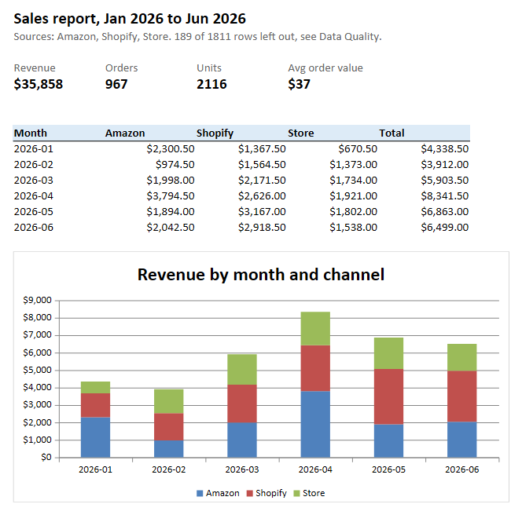
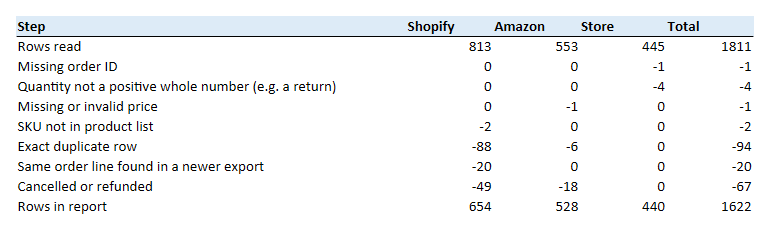

# Sales Data Cleanup: Messy CSV/Excel Exports → One Clean Excel Report

A small business sells on Shopify, on Amazon and in a shop. Every month someone downloads three exports in three different formats, pastes them into one spreadsheet, fixes them by hand, and builds a report. This project does that in one command:

```bash
python run.py
```

It reads every export in `data/raw/`, maps them onto one schema, cleans and de-duplicates the rows, and writes:

- `output/sales_report.xlsx`: summary with a chart, product ranking, the clean data, and a data quality sheet
- `output/clean_orders.csv`: the clean rows, ready for a database or BI tool

**Every row is accounted for.** Each input row ends up either in the report or on the *Removed Rows* sheet, with the reason and its original file and row number. The script stops if the two don't add up.



## Results on the sample data

1,811 rows read from 4 files. 1,622 rows in the report, 189 left out:



The sample exports are synthetic (made by [`generate_data.py`](generate_data.py) with a fixed seed), so the repository contains no real customer data. They copy the quirks of real Shopify, Amazon and till exports.

## What it handles

| Problem in the raw files | How it is handled |
|---|---|
| Three sources, three layouts: CSV with a byte-order mark, tab-separated text, Excel with a title above the header | One mapping per source in [`config.py`](config.py). Adding a source means adding a mapping, not code. |
| Shopify fills email, date and status on the **first line item only** | Filled down within each order. |
| Store dates are day-first text (`03/04/2026` is 3 April), mixed with real Excel date cells | Each source's date format is set explicitly; pandas is never left to guess day vs month. |
| Shopify and Amazon timestamps carry time zones | Converted to the business's time zone before taking the date, so late-evening orders land on the right day and month. |
| Prices as text (`$16.00`) next to plain numbers; quantities as text (`"2 "`) | Parsed to numbers, including thousands separators like `$1,249.00`. |
| Amazon's `item-price` is the line total, not the unit price | Divided by quantity (set per source). |
| SKUs as `mug-002`, ` MUG-002 `; emails in mixed case | Normalised, then SKUs are matched against the product list; unknown SKUs are reported, not silently dropped. |
| Overlapping exports: March appears in both Shopify files | Exact duplicates are removed. When the same order line differs between files (e.g. *pending* in the March export, *paid* or *refunded* in the June one), the newer file wins. |
| Part of the Amazon report pasted in twice | Exact duplicates removed. |
| Returns logged as negative quantities, a TOTAL row at the bottom, blank rows, missing prices | Left out with a reason on the *Removed Rows* sheet. |
| Cancelled and refunded orders | Excluded from revenue, counted on the Data Quality sheet. |

Before and after, three store lines:

| Raw date | Raw SKU | Raw price | Raw email | → | Date | SKU | Price | Email |
|:--|:--|:--|:--|:-:|:--|:--|--:|:--|
| `05/01/2026` | `" mug-002"` | `24` | `customer344@example.com` | | 2026-01-05 | MUG-002 | 24.00 | customer344@example.com |
| `06/01/2026` | `CND-050` | `"$16.00"` | *(blank)* | | 2026-01-06 | CND-050 | 16.00 | *(blank)* |
| `10/01/2026` | `TEA-010` | `9.5` | `CUSTOMER47@EXAMPLE.COM` | | 2026-01-10 | TEA-010 | 9.50 | customer47@example.com |

## The report

| Sheet | Contents |
|---|---|
| Summary | Revenue, orders, units, average order value; revenue by month and channel, with a native Excel chart |
| Products | Units, revenue and share of revenue per product |
| Clean Data | Every clean row with source file and row number, filters on, header frozen |
| Data Quality | Rows read, removed per reason, and kept, per source. Each column adds up. |
| Removed Rows | Every row left out, with the reason, file and row number, so it can be checked or fixed at the source |

## Run it

```bash
python -m venv .venv
.venv\Scripts\activate          # macOS/Linux: source .venv/bin/activate
pip install -r requirements.txt
python generate_data.py         # writes the sample exports to data/raw/
python run.py                   # or: python run.py --input D:\exports --output D:\reports
```

## Using it on your own files

1. Put the exports in one folder.
2. In [`config.py`](config.py), set for each source: the file name pattern, which column means what, the date format, and which statuses to exclude.
3. Put your product list in `data/products.csv` (`sku, product, category`).
4. Run `python run.py --input <folder>`.

## Scheduling

Windows Task Scheduler, on the 1st of every month at 08:00:

```bat
schtasks /create /tn "sales-report" /sc monthly /d 1 /st 08:00 ^
  /tr "C:\path\to\project\.venv\Scripts\python.exe C:\path\to\project\run.py"
```

Linux cron: `0 8 1 * * cd /path/to/project && .venv/bin/python run.py`

## Tests

```bash
pytest -q
```

The tests cover day-first and Excel date cells, time zone conversion, money parsing, Shopify fill-down, Amazon line totals, a newer export overriding an older one (including a refund), duplicate removal, a reason for every rejected row, and an end-to-end run where every row is accounted for and the report totals match the clean data.

## Project layout

```
run.py             CLI: read the folder, clean, write CSV + Excel
clean.py           loading, type cleanup, validation, de-duplication
report.py          Excel report (xlsxwriter)
config.py          per-source column mappings, date formats, statuses
generate_data.py   synthetic sample exports
data/products.csv  product list
tests/             pytest suite
```
